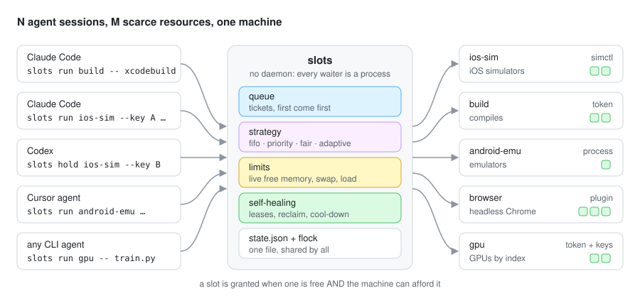
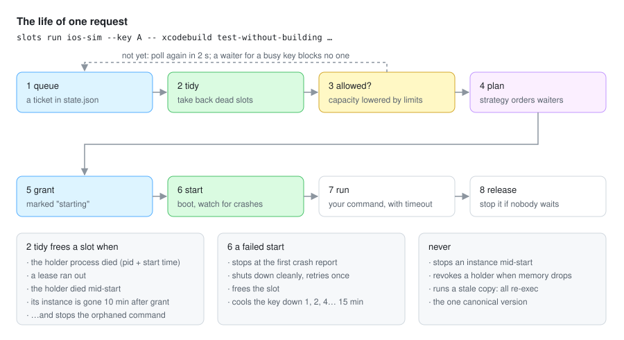
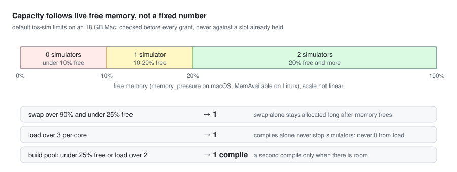
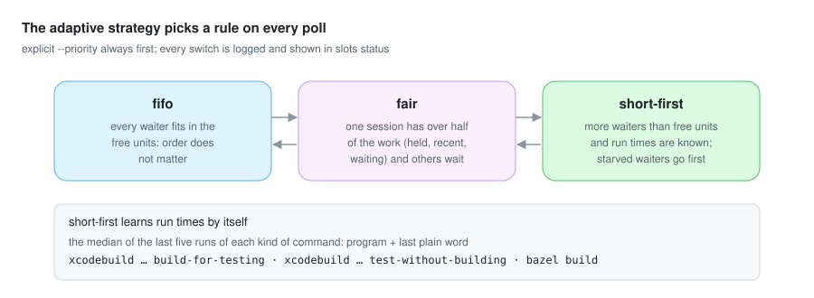

<div align="center">

# Agent Slots

**Many AI agents, one machine, a few heavy resources. `slots` hands them out so nothing swaps, crashes or sits idle.**

[](LICENSE)


English · [Русский](README.ru.md)



</div>

## The problem

You run ten or fifteen agent sessions at once: Claude Code, Codex, Cursor, any CLI agent, each in its own git
worktree. Each one decides by itself when to compile, boot an iOS simulator, start an Android emulator, open a
browser or take the GPU. None of them knows about the others.

What happened on one 18 GB MacBook with fifteen agents building one iOS app, over four days:

- three simulators booted at once, swap hit 14.5 of 15 GB, load 234, and SpringBoard crash-looped 12 times in two minutes;
- with one global lock, both simulators sat idle while one agent compiled and 16 commands queued;
- a hung test kept a simulator for 47 minutes, and old copies of the lock script held both slots for hours;
- a swap-based memory check refused to boot anything at 37% free memory, and five agents waited two hours.

`flock` and GNU `sem` give you a semaphore, and cluster schedulers need daemons and a cluster. `slots` sits between
them: a single command that agents wrap their heavy work in. It knows what the machine can afford right now and
recovers on its own when an agent dies, hangs or forgets.

## Quick start

### Claude Code plugin (easiest)

```text
/plugin install agent-slots --marketplace staterijndael/agent-slots
```

On older Claude Code: `/plugin marketplace add staterijndael/agent-slots`, then `/plugin install agent-slots@agent-slots`.
The plugin gives every session the `slots` command (as `${CLAUDE_PLUGIN_ROOT}/scripts/slots`), tells each new session that heavy work goes through it, writes a
starter config on first use, and refuses direct `xcodebuild`, `xcrun simctl boot`, `./gradlew` builds and
`emulator -avd` for pools you have, with a message that shows the `slots` command to run instead.
`/agent-slots:setup` sizes the pools for your machine; `/agent-slots:status` explains the queue.

#### What the plugin runs on your machine
Everything is local Python from this repository; nothing is sent over the network ([PRIVACY.md](PRIVACY.md)).
- **SessionStart hook** (`plugin/session_start.py`): copies the `agent_slots` package into the plugin's data
  folder, writes `~/.agent-slots/config.json` if it does not exist, and adds one paragraph to the session's
  context naming the pools and the `slots` command.
- **PreToolUse hook on Bash** (`plugin/guard.py`): reads the command the agent is about to run and refuses it
  (exit 2, with the `slots` command to use instead) when it is a direct compile, simulator boot or emulator start
  for a pool in your config. It never runs or changes the command, and lets everything through on any error.
- **`slots` itself** (`scripts/slots`, run by the agent): reads and writes `~/.agent-slots/`, reads memory, swap,
  load and the process list, and starts and stops the simulators, emulators or processes your pools name.

Works in Claude Code, and in Cowork when the session runs on your computer. On claude.ai chat only the skills load,
and they have nothing to act on there.

### Any agent (Codex, Cursor, scripts)

```bash
git clone https://github.com/staterijndael/agent-slots ~/src/agent-slots
ln -s ~/src/agent-slots/scripts/slots ~/.local/bin/slots    # any folder on your PATH
slots init                                              # writes ~/.agent-slots/config.json
```

Then wrap heavy commands:

```bash
slots run build -- xcodebuild build-for-testing …                  # one of two compile slots
slots run ios-sim --key $UDID -- xcodebuild test-without-building -destination "id={key}" …
slots hold ios-sim --key $UDID --minutes 10                        # boot it and lease it for a hands-on check
slots renew                                                        # still working: extend the lease
slots release                                                      # done: give it back
slots status                                                       # who holds what, who waits, and why
```

```text
$ slots status
memory 29% free, swap 93% used, load 9.55/core; config: ~/.agent-slots/config.json
ios-sim (simctl, fifo): 1/1 held, capacity 2, lowered by load 9.55/core
  held: chat-c on iPhone 17 Pro (chat-c), 1 unit(s), 19 s, pid 58843: xcodebuild … test-without-building
  instances: 38 known, running now: iPhone 17 Pro (chat-c)
build (token, adaptive now fair: chat-a has 5 of 7 units): 1/1 held, capacity 2, lowered by load 9.55/core
  held: chat-a, 1 unit(s), 40 s, pid 60112: xcodebuild … build-for-testing
  waiting: chat-b, 12 s
```

Python 3.9 or newer, standard library only; the macOS system `python3` works. Linux works too, without the `simctl` type.

## Tell your agents

Paste this into `CLAUDE.md`, `AGENTS.md` or your agent's instructions. The user-level file is a good place,
since the resources belong to the machine:

```markdown
## Heavy resources: always through `slots`
Several agent sessions share this machine. Never boot a simulator or emulator, start a compile, or launch a
browser for testing directly. Wrap the command in `slots`, which queues it and starts it when the machine can
afford it. `--owner` is your session's name.
- Compile: `slots run build --owner <name> -- <build command>`. For a build that alone fills the machine, add `--exclusive`.
- Tests on a simulator: `slots run ios-sim --owner <name> --key <udid> -- <test command>`; `{key}` in the command
  becomes the udid. Build first in the `build` pool. The simulator slot is only for the run.
- Hands-on check: `slots hold ios-sim --owner <name> --key <udid> --minutes 10`, then `slots renew --owner <name>`
  while you work and `slots release --owner <name>` when done. Do not hold a slot while you wait for a human.
- `slots status` shows holders, the queue and why a slot is not granted. Waiting can take minutes, so run long
  `slots run` calls in the background instead of hitting your tool's command timeout.
- Exit 75: the instance failed to start recently and is cooling down; pick another key or wait.
  Exit 124: your command hit the pool's run timeout.
```

In Claude Code, also keep `Bash(xcodebuild:*)`, `Bash(xcrun simctl boot:*)` and similar out of the allow list, so an
agent asks before it bypasses the queue.

## How it works



There is no daemon. Every waiting agent is its own small process that polls one JSON state file under `flock`
(every 2 s by default). On each poll it tidies the state for everyone, checks what the machine can afford, and
asks the pool's strategy whether it is next. Every waiter computes the same plan from the same state, so the
strategy decides who goes next, not whoever polls first. If a waiter dies, the next poll cleans up after it.

### Capacity follows the machine



Each pool has a capacity and a list of limits. Each limit lowers the capacity while all of its conditions hold:
`free_below`, `free_above`, `swap_above` (percent) and `load_above` (load average per core). Limits only gate new
grants. A holder never loses its slot because memory dropped; the pool waits for it to finish instead.

### Strategies

| Strategy | Who goes next |
|---|---|
| `fifo` | first come, first served |
| `priority` | higher `--priority` first; a waiter gains one step every `aging_minutes`, so low priorities are not starved |
| `fair` | the session using the least of the pool: units held now plus slots granted in the last `fair_window_minutes` |
| `adaptive` | switches between the rules above by what the queue looks like |



In every strategy, a waiter for a busy key is skipped instead of waited on, so it never blocks the queue. A big
waiter (`--exclusive`) lets smaller ones pass for `backfill_seconds`. After that it keeps the room, so it cannot
starve.

## Configuration

One file per machine, `~/.agent-slots/config.json` (`$SLOTS_HOME`, or `$SLOTS_CONFIG` for the file itself).
It is re-read on every poll, so a change reaches agents that are already waiting.

```json
{
  "canonical": "/Users/me/src/agent-slots/agent_slots",
  "pools": {
    "ios-sim": {"type": "simctl", "capacity": 2, "limits": [
      {"when": {"free_below": 10}, "max": 0},
      {"when": {"free_below": 20}, "max": 1},
      {"when": {"swap_above": 90, "free_below": 25}, "max": 1},
      {"when": {"load_above": 3}, "max": 1}]},
    "build": {"type": "token", "capacity": 2, "strategy": "adaptive",
              "limits": [{"when": {"free_below": 25}, "max": 1}, {"when": {"load_above": 2}, "max": 1}]},
    "gpu": {"type": "token", "capacity": 2, "keys": ["0", "1"], "env": {"CUDA_VISIBLE_DEVICES": "{key}"}}
  }
}
```

<details>
<summary><b>All pool fields</b></summary>

| Field | Default | Meaning |
|---|---|---|
| `type` | `token` | `token`, `process`, `simctl`, or a plugin: `/path/file.py:Class` or `module:Class` |
| `capacity` | 1 | the most units the pool grants at once |
| `limits` | `[]` | `{"when": {...}, "max": N}` lowers the capacity while every condition holds |
| `strategy` | `fifo` | `fifo`, `priority`, `fair`, `adaptive` |
| `keys` | `[]` | instances to pick from when `--key` is not given (AVD names, GPU indexes, ports) |
| `env` | `{}` | extra environment for `run`; `{key}` is replaced |
| `lease_minutes` / `max_lease_minutes` | 10 / 30 | `hold` lease length and its cap |
| `run_timeout` | 1200 | seconds before `run` stops a hung command and frees its slot |
| `stale_seconds` | 600 | a holder whose instance is not running this long after the grant loses its slot |
| `start_timeout` | 180 | seconds an instance may take to start |
| `backfill_seconds` | 120 | how long a big waiter lets smaller ones pass |
| `stop_on_release` | true | stop an instance when its slot is freed and nobody waits for it |
| `strays` | `stop-when-needed` | instances running without a slot: stop them when room is needed, `count` them only, or `ignore` them |
| `aging_minutes` | 5 | `priority`: one step gained per this many minutes waited |
| `fair_window_minutes` | 10 | `fair`, `adaptive`: how long a grant counts as use |
| `starve_minutes` | 10 | `adaptive`: after this long a waiter goes first, whatever its run time |

`canonical` names the one copy of the tool every agent must run. Agents copy and branch tools, and old copies once
held both simulators for hours. With `canonical` set, any other copy re-executes the canonical one, and a waiter
re-executes when the canonical copy changes. It keeps its place in the queue.

</details>

## Resource types

- **`token`**: a counting semaphore for compiles, test runners, licenses, or GPU indexes (with `keys` and `env`).
- **`process`**: an instance is a process that `slots` starts (`start` argv), waits for (`ready` argv, polled until
  it exits 0) and stops (`stop` argv, or SIGTERM then SIGKILL to its process group). Use it for Android emulators,
  browsers, IDEs and local servers.
- **`simctl`**: iOS simulators by udid. It boots only a fully shut-down device, stops at the first SpringBoard crash
  report and retries once, gives up a boot after `start_timeout`, and finds simulators booted without a slot.
- **Plugins**: subclass `agent_slots.resources.ResourceType` and override what you need: `start(key, timeout)`,
  `stop(key, reason)`, `running()`, `busy_elsewhere(key)`, `names()`. See [examples/chrome_plugin.py](examples/chrome_plugin.py).

## Compared with

| | flock / GNU `sem` | simulator lockers¹ | Block agent-task-queue | Slurm / Nomad | **slots** |
|---|---|---|---|---|---|
| Capacity N per resource | `sem` only | ✓ | ✓ | ✓ | ✓ |
| Capacity from live memory and load | – | – | – | with daemons | ✓ graded, before each grant |
| Leases; reclaim dead or expired holders | – | ✓ | pid only | ✓ | ✓ plus pid-reuse check |
| Reclaim a holder whose instance is gone | – | – | – | – | ✓ |
| Starts, watches and stops instances | – | partly | – | – | ✓ never mid-start |
| Crash-loop detection and cool-down | – | – | – | – | ✓ |
| fifo, priority, fair, adaptive | – | fifo | fifo | ✓ | ✓ |
| Any resource through plugins | – | devices | commands | ✓ | ✓ |
| No daemon | ✓ | ✓ | MCP server | – | ✓ |

¹ [simbroker](https://github.com/RyanJThompson/simbroker), [SimLease](https://github.com/alexissan/simlease),
[mic-lock](https://github.com/Michael23Magdy/mic-lock). Also see [Block's agent-task-queue](https://github.com/block/agent-task-queue).

## FAQ

**Why no daemon?** A daemon has to be installed, started, upgraded and watched, and an agent cannot tell a dead
daemon from a long queue. A file under `flock` survives any participant crashing, and every waiter cleans up for
everyone. The cost is a few small subprocess calls per second with fifteen waiters, which is noise next to one compile.

**My agent's shell tool times out after a few minutes.** Run long `slots run` calls in the background (Claude Code:
`run_in_background`), or `slots hold` first and run your command after it returns.

**Does it work across machines?** Not yet: one machine, one state file.

**What does it learn?** Only the run time of each kind of command (the program plus its last plain word), so the
`adaptive` strategy can put short jobs first when the queue is long.

## Development

```bash
python3 -m unittest discover tests      # 41 cases: a fake simctl, fake memory readings, the plugin hooks
```

Each case is an incident or a rule; [docs/DESIGN.md](docs/DESIGN.md) lists the incidents behind the rules.
The diagrams are generated by `docs/img/make.py`.

## License

[MIT](LICENSE)
