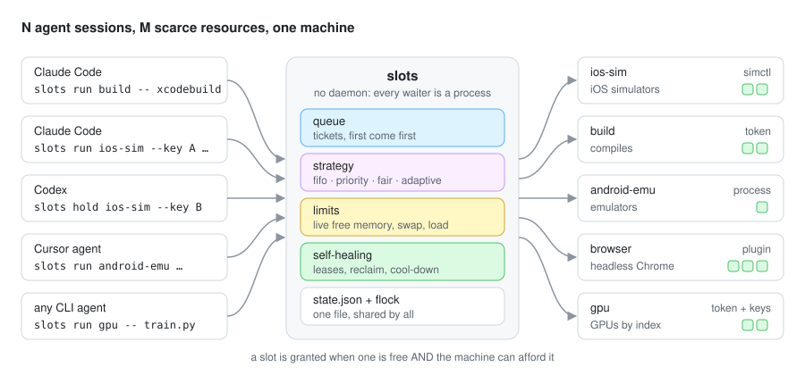
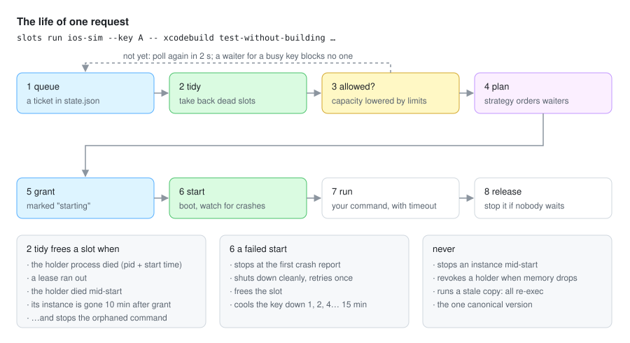
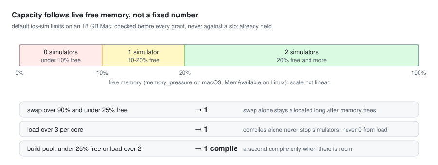
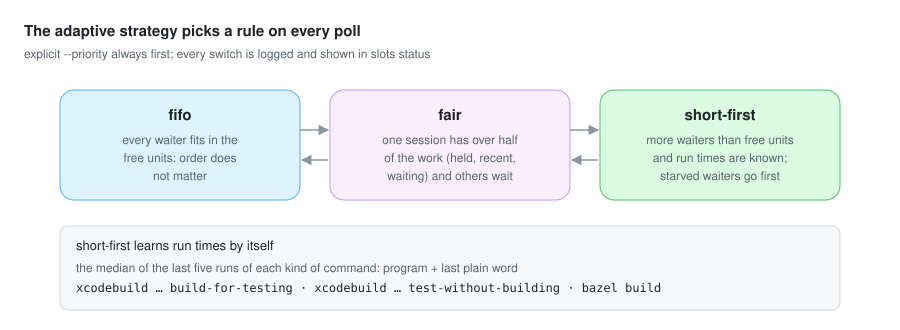

<div align="center">

# Agent Slots

**Много ИИ-агентов на одной машине и несколько тяжёлых ресурсов. `slots` раздаёт их так, чтобы ничего не уходило в своп, не падало и не простаивало.**

[](LICENSE)


[English](README.md) · Русский



</div>

## Проблема

Вы запускаете сразу десять-пятнадцать сессий агентов: Claude Code, Codex, Cursor, любой CLI-агент, каждый в
своём git worktree. Каждый сам решает, когда собрать проект, загрузить iOS-симулятор, поднять Android-эмулятор,
открыть браузер или занять GPU. Друг о друге агенты не знают.

Вот что случилось за четыре дня на одном MacBook с 18 ГБ, где пятнадцать агентов строили одно iOS-приложение:

- загрузились три симулятора сразу, своп дошёл до 14.5 из 15 ГБ, нагрузка до 234, и SpringBoard падал 12 раз за две минуты;
- с одним общим lock'ом оба симулятора простаивали, пока один агент компилировал, а в очереди стояло 16 команд;
- зависший тест держал симулятор 47 минут, а старые копии скрипта-lock'а держали оба слота часами;
- проверка памяти по свопу не давала загрузить ничего при 37% свободной памяти, и пять агентов ждали два часа.

`flock` и GNU `sem` дают семафор, а кластерным планировщикам нужны демоны и кластер. `slots` стоит между ними: это
одна команда, в которую агенты оборачивают тяжёлую работу. Она знает, что машина может себе позволить прямо
сейчас, и сама восстанавливается, когда агент умер, завис или что-то забыл.

## Быстрый старт

### Плагин для Claude Code (проще всего)

```text
/plugin install agent-slots --marketplace staterijndael/agent-slots
```

В старых версиях Claude Code: `/plugin marketplace add staterijndael/agent-slots`, затем
`/plugin install agent-slots@agent-slots`. Плагин даёт каждой сессии команду `slots` (как `${CLAUDE_PLUGIN_ROOT}/scripts/slots`), сообщает каждой новой
сессии, что тяжёлая работа идёт через него, при первом запуске пишет стартовый конфиг и не даёт запустить
напрямую `xcodebuild`, `xcrun simctl boot`, сборки `./gradlew` и `emulator -avd` для пулов, которые у вас есть.
Вместо этого агент получает сообщение с нужной командой `slots`. `/agent-slots:setup` подбирает пулы под вашу
машину, `/agent-slots:status` объясняет очередь.

#### Что плагин делает на вашей машине
Всё это локальный Python из этого репозитория; в сеть ничего не уходит ([PRIVACY.md](PRIVACY.md)).
- **Хук SessionStart** (`plugin/session_start.py`): копирует пакет `agent_slots` в папку данных плагина, пишет
  `~/.agent-slots/config.json`, если его нет, и добавляет в контекст сессии один абзац с пулами и командой `slots`.
- **Хук PreToolUse на Bash** (`plugin/guard.py`): читает команду, которую агент собирается запустить, и отклоняет
  её (exit 2, с командой `slots` взамен), если это прямая сборка, загрузка симулятора или запуск эмулятора для
  пула из вашего конфига. Команду он не запускает и не меняет, а при любой ошибке пропускает.
- **Сам `slots`** (`scripts/slots`, его запускает агент): читает и пишет `~/.agent-slots/`, читает память, своп,
  нагрузку и список процессов, запускает и останавливает симуляторы, эмуляторы и процессы, которые названы в пулах.

Работает в Claude Code и в Cowork, если сессия идёт на вашем компьютере. В чате claude.ai загрузятся только
навыки, и делать там им нечего.

### Любой агент (Codex, Cursor, скрипты)

```bash
git clone https://github.com/staterijndael/agent-slots ~/src/agent-slots
ln -s ~/src/agent-slots/scripts/slots ~/.local/bin/slots    # любая папка из PATH
slots init                                              # создаёт ~/.agent-slots/config.json
```

Дальше тяжёлые команды оборачиваются так:

```bash
slots run build -- xcodebuild build-for-testing …                  # один из двух слотов сборки
slots run ios-sim --key $UDID -- xcodebuild test-without-building -destination "id={key}" …
slots hold ios-sim --key $UDID --minutes 10                        # загрузить и арендовать для ручной проверки
slots renew                                                        # ещё работаю: продлить аренду
slots release                                                      # готово: вернуть
slots status                                                       # кто что держит, кто ждёт и почему
```

```text
$ slots status
memory 29% free, swap 93% used, load 9.55/core; config: ~/.agent-slots/config.json
ios-sim (simctl, fifo): 1/1 held, capacity 2, lowered by load 9.55/core
  held: chat-c on iPhone 17 Pro (chat-c), 1 unit(s), 19 s, pid 58843: xcodebuild … test-without-building
  instances: 38 known, running now: iPhone 17 Pro (chat-c)
build (token, adaptive now fair: chat-a has 5 of 7 units): 1/1 held, capacity 2, lowered by load 9.55/core
  held: chat-a, 1 unit(s), 40 s, pid 60112: xcodebuild … build-for-testing
  waiting: chat-b, 12 s
```

Нужен Python 3.9 или новее, только стандартная библиотека; системный `python3` на macOS подходит. На Linux тоже
работает, но без типа `simctl`.

## Скажите агентам

Вставьте это в `CLAUDE.md`, `AGENTS.md` или инструкции вашего агента. Удобнее всего в пользовательский файл,
потому что ресурсы принадлежат машине:

```markdown
## Heavy resources: always through `slots`
Several agent sessions share this machine. Never boot a simulator or emulator, start a compile, or launch a
browser for testing directly. Wrap the command in `slots`, which queues it and starts it when the machine can
afford it. `--owner` is your session's name.
- Compile: `slots run build --owner <name> -- <build command>`. For a build that alone fills the machine, add `--exclusive`.
- Tests on a simulator: `slots run ios-sim --owner <name> --key <udid> -- <test command>`; `{key}` in the command
  becomes the udid. Build first in the `build` pool. The simulator slot is only for the run.
- Hands-on check: `slots hold ios-sim --owner <name> --key <udid> --minutes 10`, then `slots renew --owner <name>`
  while you work and `slots release --owner <name>` when done. Do not hold a slot while you wait for a human.
- `slots status` shows holders, the queue and why a slot is not granted. Waiting can take minutes, so run long
  `slots run` calls in the background instead of hitting your tool's command timeout.
- Exit 75: the instance failed to start recently and is cooling down; pick another key or wait.
  Exit 124: your command hit the pool's run timeout.
```

Текст для агентов оставлен на английском: так его одинаково понимают все агенты. В Claude Code также не
добавляйте в список разрешённых `Bash(xcodebuild:*)`, `Bash(xcrun simctl boot:*)` и похожие правила, чтобы агент
спрашивал, прежде чем обойти очередь.

## Как это работает



Демона нет. Каждый ожидающий агент — свой маленький процесс, который опрашивает один JSON-файл состояния под
`flock` (по умолчанию раз в 2 секунды). При каждом опросе он прибирает состояние за всех, проверяет, что машина
может себе позволить, и спрашивает стратегию пула, его ли очередь. Все ожидающие считают один и тот же план из
одного и того же состояния, поэтому порядок решает стратегия, а не тот, кто опросил первым. Если ожидающий умер,
следующий опрос уберёт за ним.

### Ёмкость следует за машиной



У каждого пула есть ёмкость и список лимитов. Лимит снижает ёмкость, пока выполняются все его условия:
`free_below`, `free_above`, `swap_above` (в процентах) и `load_above` (средняя нагрузка на ядро). Лимиты
проверяются только перед новой выдачей. Держатель никогда не теряет слот из-за того, что упала память: пул ждёт,
пока он закончит.

### Стратегии

| Стратегия | Кто идёт следующим |
|---|---|
| `fifo` | кто раньше пришёл |
| `priority` | сначала больший `--priority`; каждые `aging_minutes` ожидания добавляют ступень, поэтому низкий приоритет не ждёт вечно |
| `fair` | та сессия, что меньше всех пользуется пулом: держит сейчас плюс получила за последние `fair_window_minutes` |
| `adaptive` | сама переключается между правилами выше, глядя на очередь |



В любой стратегии ожидающего занятого устройства планировщик пропускает, а не ждёт, поэтому очередь он не держит.
Большой ожидающий (`--exclusive`) пропускает мелких `backfill_seconds` секунд. Потом место держится за ним,
поэтому вечно он не ждёт.

## Настройка

Один файл на машину: `~/.agent-slots/config.json` (папка задаётся `$SLOTS_HOME`, сам файл `$SLOTS_CONFIG`).
Он перечитывается при каждом опросе, поэтому изменение доходит и до агентов, которые уже ждут.

```json
{
  "canonical": "/Users/me/src/agent-slots/agent_slots",
  "pools": {
    "ios-sim": {"type": "simctl", "capacity": 2, "limits": [
      {"when": {"free_below": 10}, "max": 0},
      {"when": {"free_below": 20}, "max": 1},
      {"when": {"swap_above": 90, "free_below": 25}, "max": 1},
      {"when": {"load_above": 3}, "max": 1}]},
    "build": {"type": "token", "capacity": 2, "strategy": "adaptive",
              "limits": [{"when": {"free_below": 25}, "max": 1}, {"when": {"load_above": 2}, "max": 1}]},
    "gpu": {"type": "token", "capacity": 2, "keys": ["0", "1"], "env": {"CUDA_VISIBLE_DEVICES": "{key}"}}
  }
}
```

<details>
<summary><b>Все поля пула</b></summary>

| Поле | По умолчанию | Что значит |
|---|---|---|
| `type` | `token` | `token`, `process`, `simctl` или плагин: `/path/file.py:Class` либо `module:Class` |
| `capacity` | 1 | сколько единиц пул выдаёт одновременно, не больше |
| `limits` | `[]` | `{"when": {...}, "max": N}` снижает ёмкость, пока выполнены все условия |
| `strategy` | `fifo` | `fifo`, `priority`, `fair`, `adaptive` |
| `keys` | `[]` | экземпляры, из которых выбирать, если `--key` не задан (имена AVD, номера GPU, порты) |
| `env` | `{}` | дополнительные переменные окружения для `run`; `{key}` подставляется |
| `lease_minutes` / `max_lease_minutes` | 10 / 30 | длина аренды `hold` и её предел |
| `run_timeout` | 1200 | через сколько секунд `run` останавливает зависшую команду и освобождает слот |
| `stale_seconds` | 600 | держатель, чей экземпляр не запущен через столько секунд после выдачи, теряет слот |
| `start_timeout` | 180 | сколько секунд даётся экземпляру на запуск |
| `backfill_seconds` | 120 | сколько большой ожидающий пропускает мелких |
| `stop_on_release` | true | останавливать экземпляр, когда слот освобождён и его никто не ждёт |
| `strays` | `stop-when-needed` | экземпляры без слота: останавливать, когда нужно место, только считать (`count`) или не замечать (`ignore`) |
| `aging_minutes` | 5 | `priority`: одна ступень за столько минут ожидания |
| `fair_window_minutes` | 10 | `fair`, `adaptive`: сколько времени выдача считается использованием |
| `starve_minutes` | 10 | `adaptive`: прождав столько, задача идёт первой, какой бы длинной она ни была |

`canonical` указывает единственную копию инструмента, которую должны запускать все агенты. Агенты копируют и
ветвят инструменты, и однажды старые копии держали оба симулятора часами. Если `canonical` задан, любая другая копия
перезапускает каноническую, а ожидающий перезапускается, когда каноническая копия меняется. Место в очереди при
этом сохраняется.

</details>

## Типы ресурсов

- **`token`**: счётный семафор для сборок, раннеров тестов, лицензий или номеров GPU (вместе с `keys` и `env`).
- **`process`**: экземпляр — процесс, который `slots` запускает (`start`), ждёт готовности (`ready` опрашивается,
  пока не вернёт 0) и останавливает (`stop`, иначе SIGTERM, затем SIGKILL группе процессов). Подходит для
  Android-эмуляторов, браузеров, IDE и локальных серверов.
- **`simctl`**: iOS-симуляторы по udid. Грузит только полностью выключенное устройство, останавливается на первом
  отчёте о падении SpringBoard и пробует ещё раз, бросает загрузку через `start_timeout` и находит симуляторы,
  загруженные без слота.
- **Плагины**: унаследуйте `agent_slots.resources.ResourceType` и переопределите нужное: `start(key, timeout)`,
  `stop(key, reason)`, `running()`, `busy_elsewhere(key)`, `names()`. Пример: [examples/chrome_plugin.py](examples/chrome_plugin.py).

## Сравнение

| | flock / GNU `sem` | блокировщики симуляторов¹ | Block agent-task-queue | Slurm / Nomad | **slots** |
|---|---|---|---|---|---|
| Ёмкость N на ресурс | только `sem` | ✓ | ✓ | ✓ | ✓ |
| Ёмкость по живой памяти и нагрузке | – | – | – | с демонами | ✓ ступенчато, перед каждой выдачей |
| Аренда; возврат у умерших и просроченных | – | ✓ | только pid | ✓ | ✓ и защита от повторного pid |
| Возврат у держателя, чей экземпляр пропал | – | – | – | – | ✓ |
| Запуск, наблюдение, остановка экземпляров | – | частично | – | – | ✓ никогда посреди запуска |
| Распознавание крах-петли и пауза | – | – | – | – | ✓ |
| fifo, priority, fair, adaptive | – | fifo | fifo | ✓ | ✓ |
| Любой ресурс через плагины | – | устройства | команды | ✓ | ✓ |
| Без демона | ✓ | ✓ | MCP-сервер | – | ✓ |

¹ [simbroker](https://github.com/RyanJThompson/simbroker), [SimLease](https://github.com/alexissan/simlease),
[mic-lock](https://github.com/Michael23Magdy/mic-lock). См. также [agent-task-queue от Block](https://github.com/block/agent-task-queue).

## Вопросы

**Почему без демона?** Демон надо ставить, запускать, обновлять и сторожить, а агент не отличит умерший демон от
длинной очереди. Файл под `flock` переживает падение любого участника, и каждый ожидающий убирает за всех. Цена —
несколько маленьких вызовов подпроцессов в секунду при пятнадцати ожидающих, на фоне одной компиляции это шум.

**Инструмент shell у моего агента обрывается через несколько минут.** Запускайте длинные `slots run` в фоне (в Claude
Code `run_in_background`) или сначала `slots hold`, а команду после того, как он вернётся.

**Работает между машинами?** Пока нет: одна машина, один файл состояния.

**Чему он учится?** Только времени выполнения каждого вида команды (программа плюс её последнее простое слово),
чтобы стратегия `adaptive` ставила короткие задачи вперёд при длинной очереди.

## Разработка

```bash
python3 -m unittest discover tests      # 41 сценарий: фейковый simctl, фейковая память, хуки плагина
```

Каждый сценарий — реальный инцидент или правило; [docs/DESIGN.md](docs/DESIGN.md) перечисляет инциденты, из
которых выросли правила. Схемы рисует `docs/img/make.py`.

## Лицензия

[MIT](LICENSE)
